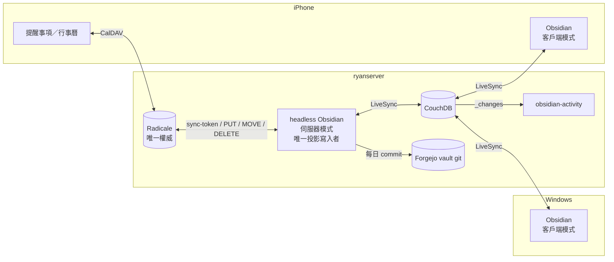

# M6 伺服器端投影：設計文件

> 狀態：設計已核可（2026-11-23）；M6-0 實測帶來的變更（§6.2 日期拆欄、§8.7 衝突處理）已確認（2026-11-23）
> 上游文件：`~/docs/homelab/services/obsidian-caldav.md`（現行 0.5.0 架構）。M6 上線後，該文件依本設計改寫。

---

## 1. 意圖

0.5.0 用 `[](cal:短ID)` 參照 + 自訂渲染 + 自製反向索引，讓筆記能引用 CalDAV 任務。它能用，但 Obsidian 原生已有的東西（連結、backlinks、hover、graph、搜尋、Properties、Bases）全都用不上，只能自己重做。

M6 把每個 CalDAV 物件**投影**成 vault 裡的一個 `.md`（frontmatter 存任務資料），參照改成原生的 `[[短ID|標籤]]`。投影由伺服器端單一節點產生，經 LiveSync 分發到各裝置；裝置上對 frontmatter 的修改經 LiveSync 回到伺服器，再寫回 CalDAV。

一句話：**讀取、檢視、關聯交給 Obsidian 原生；CalDAV 仍是唯一權威；插件只做原生做不到的兩件事——句中的即時 chip，以及投影與回寫。**

## 2. 目標、非目標、反目標

**目標**
- 用原生的 `[[` 連結、backlinks、Properties、Bases 引用與檢視任務。
- 筆記句中仍能看到並操作任務的即時狀態（chip：勾選、到期日、選單）。
- 在 Obsidian 做輕量編輯（標題、狀態、日期、清單），寫回 CalDAV。
- 多裝置一致：新裝置打開 vault 就有完整投影；搬移的修正全域生效。
- 投影檔的 body 作為 PKM 內容，可以自由書寫、連結。

**非目標**（已接受的限制）
- 重複任務的編輯（重複 VTODO 的狀態、重複 VEVENT 全部唯讀）。
- 提醒（VALARM）、重複規則的編輯；時間軸視圖。
- frontmatter／Bases 完整呈現 iCalendar 的所有欄位。
- 快照標籤保持最新（標籤可以過期，chip 顯示即時資料）。

**反目標**（技術上能動但算失敗）
- 任何檔案操作（刪檔、清資料夾、同步異常）**隱性地刪除 CalDAV 資料**。
- 投影檔 body 的內容遺失或被系統改動。
- 系統在「使用者指令」與「搬移 rename」以外寫入使用者筆記。
- 出現兩個獨立的投影寫入者，或兩份互相分歧的副本。
- 正式資料用於開發測試。

## 3. 原則（取代 0.5.0 的 P1–P3）

| | 原則 | 內容 |
|---|---|---|
| **P1** | 權威 | 任務資料的唯一權威是 CalDAV。投影檔的 **frontmatter** 是伺服器這個單一寫入者產生的衍生副本，可從 CalDAV 重建；**body** 是筆記內容，權威是 vault。筆記與任務的關聯，權威是使用者筆記裡的 `[[短ID]]`。 |
| **P2** | 寫入 | 投影目錄的結構與 frontmatter 由伺服器擁有：使用者只能改可寫欄位與 body，其他變更（刪檔、改名、搬出目錄、改系統欄位）一律回滾並通知。伺服器只透過 `processFrontMatter` 寫 frontmatter，body 一字不動。使用者筆記只在 ① 使用者下指令、② 搬移時由伺服器 `renameFile` 更新連結，這兩種情況被寫入。 |
| **P3** | 邊界 | iCalendar 標準、既有客戶端（iOS 為準，§5 例外登記表沿用）、Obsidian 原生功能，已經有的不重做，做不到的不補。 |

0.5.0 的 §5（語意分類、E1–E3）與 §4.4（讀取寬容、寫入保留、逐行修補）**全部沿用**。

## 4. 方案與決策紀錄

| # | 決策 | 考慮過的方案 | 選擇與理由 |
|---|---|---|---|
| D1 | 資料模型 | A. 現行：.md 只存 `cal:`，資料在 IndexedDB；B. 投影檔 | **B**。原生生態可直接用；投影檔本質就是衍生快取 |
| D2 | 參照形式 | 與 `cal:` 並存；取代 | **取代**為 `[[短ID\|標籤]]`。原生 backlinks 取代 M5；插件停用時仍是可讀連結。既有 `cal:` 以一次性指令遷移 |
| D3 | 標籤 | 空白（0.5.0 §6.3）；快照 | **快照**。`[[` 比對 alias 時自然產生；解決「插件失效不可讀、搜尋不到、匯出看不到」三項代價；§6.5 退出指令不再需要 |
| D4 | 渲染 | 取代連結（M2）；在連結後附加 widget；純 CSS（Supercharged Links） | **附加 widget**。連結維持原生（點擊、hover、改名）；只有 chip 是自訂的 |
| D5 | iOS 搬清單（換 UID） | 導向 stub；rename 投影檔 | **rename**（使用者決定：更乾淨）。由 Obsidian 更新所有連結，全域生效 |
| D6 | 投影產生處 | 每台裝置各自產生（LiveSync ignore）；伺服器產生並同步 | **伺服器**。rename 只有一個節點做，避免多裝置同時改寫筆記；客戶端不需同步引擎、快取、帳密；LiveSync 即離線佇列；Radicale、CouchDB 本就同機，不新增故障點 |
| D7 | 伺服器實作形式 | headless Obsidian 插件伺服器模式；獨立 daemon 聽 CouchDB `_changes` | **插件伺服器模式**。沿用既有程式碼，`renameFile`、`processFrontMatter`、`metadataCache` 現成；daemon 要自己處理連結改寫與 LiveSync 分塊格式，違反 P3 |
| D8 | 寫入回饋 | 只看 chip；通知 | **狀態落在 frontmatter（`_sync` 等），用通知呈現**；衝突對話框在裝置上 |
| D9 | 新建 | 伺服器指派 UID 再 rename；客戶端產生 UID | **客戶端產生 UUIDv4**。建立當下就是最終檔名，離線可用 |
| D10 | 投影檔被刪除／改名 | 不代表任何事；刪檔即刪任務；禁止並回滾 | **禁止，回滾並通知**（使用者決定）。刪任務只能透過明確指令或原生客戶端 |
| D11 | body | 系統擁有；使用者內容 | **使用者內容**，不解析、不處理、不寫回 CalDAV（使用者決定）。CalDAV 的 DESCRIPTION 放唯讀欄位 `_notes` |
| D13 | 投影範圍 | 全部投影；加時間篩選 | **全部**（白名單集合內），排除測試集合（使用者決定）。已完成項目是 PKM 歷史，Bases 可依 `status` 篩；時間篩選會讓有 body 的檔案進出範圍 |
| D12 | vault git、obsidian-activity | — | 投影檔照常 commit（git 歷史即任務變更紀錄）；obsidian-activity 不改動（使用者決定） |

## 5. 拓撲



- 只有伺服器模式連 CalDAV。客戶端模式不持有 CalDAV 帳密、同步引擎、IndexedDB 快取、待送佇列。
- 同一個插件，設定裡選模式（伺服器／客戶端）。未設定時為客戶端。
- 伺服器模式只會在 headless 實例的正式 vault 啟用一次；同時有兩個伺服器模式實例是設定錯誤，插件應偵測並拒絕（見 §11 L3）。

## 6. 投影檔

### 6.1 範圍、位置與檔名

- **範圍（使用者決定）**：白名單內集合的所有物件都投影，包括已完成、已取消的 VTODO（含 iOS 重複提醒每次完成產生的副本）、所有 VEVENT（含過去與重複事件）。沒有時間篩選。白名單在伺服器模式設定裡；`/ryanw/test/` 不在白名單內。估計十年約 1 萬個檔案。
- 集合從白名單移除時：既有投影檔不刪、body 不動，frontmatter 標 `_sync: rejected`、`_sync_msg: 集合不在投影範圍`，之後不再更新。

- 目錄：vault 根目錄的 `caldav/`。不以底線開頭：投影檔（含 body）是 PKM 的一部分（使用者決定，2026-11-23；原提議為 `_caldav/`）。
- 檔名：`<短ID>.md`，短 ID 算法沿用 0.5.0（`sha256(UID)` → Crockford base32 小寫前 8 位）。
- 清單列表：`caldav/_lists.md`，frontmatter 列出集合（href、顯示名稱、元件類型），供客戶端新建時離線選取。由伺服器維護，同樣適用回滾規則。

### 6.2 frontmatter

```yaml
---
# 可寫欄位（使用者、chip、Properties、Bases）
title: 交週報
status: needs-action          # VTODO：needs-action / in-process / completed / cancelled
due: 2026-11-24               # VTODO；型別 date，一律只放日期
due_time: "09:30"             # 型別 text（HH:mm）；沒有此欄位 = 全天
# start / start_time / end / end_time   # VEVENT 用這些，取代 status / due / due_time
#   全天 VEVENT 的 end 是「含當天」：DTEND（不含）減一天；寫回時加一天（2026-11-23 決定，比照 Full Calendar）
list: tasks                   # 集合的短名；改了觸發 MOVE（S4 已驗證）
# 系統欄位（改了會被回滾）
aliases: [交週報]              # 跟著 title；供 [[ 自動完成
_kind: VTODO
_uid: 6f1c…
_notes: …                     # CalDAV DESCRIPTION，唯讀
_rrule: 每週一                 # 人讀的描述，唯讀；有值時依 editable() 鎖欄位
_etag: "a1b2…"
_hash: 9f3e…                  # 可寫欄位的正規化雜湊（伺服器投影時寫入）
_sync: ok                     # ok / rejected / conflict
_sync_msg:
_conflict:                    # 衝突時：{欄位: {mine, theirs}}
_deleted: false
_request:                     # 客戶端→伺服器的指令管道：delete / dismiss-conflict
---
（body：使用者內容）
```

- **可寫性**沿用 `src/ical/editable.ts`：重複 VTODO 的 `status` 唯讀；重複 VEVENT、帶 override 的物件全部唯讀；`_deleted: true` 時全部唯讀。
- **時間格式（S3 後改，已確認；M6-1 開頭補測 `due_time` 在 Properties／Bases 的寫入原文——`09:30` 不加引號時 YAML 1.1 會當成數字——以及各裝置 `setType` 的效果；格式不合 `HH:mm` → `_sync: rejected`）**：Obsidian 的 property 型別是整個 vault 一種（`.obsidian/types.json`，且不經 LiveSync 同步），同一欄位不能有時是 date、有時是 datetime（date 型別會藏掉時間、datetime 型別會把全天變成 00:00）。所以日期與時間拆成兩欄：`due`（date）＋`due_time`（text，`HH:mm`）。沒有 `due_time` 寫回 `VALUE=DATE`，有就寫 `TZID=Asia/Taipei`（E3）；使用者新增或刪除 `due_time` 即改變形式。客戶端與伺服器模式啟動時用 `app.metadataTypeManager.setType` 設定 `due`、`start`、`end` 為 date，`*_time` 為 text（每台裝置各自需要；前提是 LiveSync 的 Hidden File Sync 不啟用，這是 `services/obsidian-server.md` 既有的原則）。
- **系統欄位一律 `_` 前綴**，讓人一眼看出改了無效；`aliases` 例外（Obsidian 指定名稱）。
- `_hash` 定義：可寫欄位依固定順序、正規化值後序列化再雜湊。客戶端與伺服器用同一函式。

### 6.3 body

- 純使用者內容，系統不解析、不改寫、不寫回 CalDAV。
- 伺服器所有寫入都用 `processFrontMatter`，不得以整檔覆寫的方式寫投影檔（新建投影檔除外，此時 body 為空）。
- 任務刪除後，投影檔與 body 保留（`_deleted: true`）。

## 7. 元件與職責

### 7.1 伺服器模式

| 元件 | 職責 | 來源 |
|---|---|---|
| 同步引擎 | sync-token 增量、過期退回全量、刪除偵測 | 沿用 `src/sync/engine.ts` |
| 搬移偵測 | CREATED＋SUMMARY 比對 | 沿用 `src/sync/moves.ts`；結果改為觸發 rename，不寫 aliases store |
| 快取 | 物件、tombstone，以及新 store **`projections`**：每個投影檔的完整最後內容（含 body）、上次投影的可寫欄位值、`_etag` | 擴充 `src/cache/db.ts` |
| 投影器 | 物件 → frontmatter；**只在值改變時寫入**；維護 `_lists.md` | 新 |
| 上行處理 | 以 `metadataCache.on('changed')` 觸發（`modify` 當下 metadataCache 仍是舊值，S3）；delete／rename 用 vault 事件；依檔案 debounce 1 s；讀 frontmatter 與上次投影比對出差異 | 新 |
| 寫回 | 差異 → `If-Match` + M4 逐行修補 → 成功後重新投影；412 → M4 自動合併，合併不了寫 `_sync: conflict` | 沿用 `src/ical/patch.ts`、`src/caldav/client.ts` |
| 回滾兜底 | 刪除／改名／搬出 → 從 `projections` 還原（含 body）；系統欄位被改 → 重新投影 frontmatter | 新 |
| ~~遷移指令~~ | 取消（2026-11-23 使用者決定：既有 12 個 `cal:` 參照不轉換） | — |

觸發：定時同步（沿用現有間隔設定）。Radicale storage hook 即時觸發列為日後選項，不在 M6。

### 7.2 客戶端模式

| 元件 | 職責 | 來源 |
|---|---|---|
| chip 渲染 | 對解析到 `caldav/` 檔案的 wikilink，在連結**後面**附加 chip（☐、日期、⋯、狀態燈）；資料讀 `metadataCache`；`changed` 時重繪 | 改寫 `src/render/`；閱讀模式選 `a.internal-link`，Live Preview 用 `Decoration.widget(side:1)` |
| chip 寫入 | 所有修改透過 `processFrontMatter` 寫可寫欄位或 `_request` | 新 |
| 狀態燈 | `_sync` 為 rejected／conflict → 紅；目前可寫欄位雜湊 ≠ `_hash` → 等待中；否則正常；`_deleted` → 已刪除 | 新 |
| 守門 | 投影檔 `changed` 時本機檢查，改了唯讀欄位立即通知（不自行還原，由伺服器回滾）；刪除／改名立即還原並通知 | 新 |
| 回饋 | 監看 `_sync` 變化 → 通知；conflict 時通知附按鈕開啟選擇對話框 | 改寫 `src/ui/` 既有衝突 UI |
| 新建指令 | 對話框（標題、清單、類型、日期）→ 本機產生 UID → 建立投影檔（無 `_etag`）→ 插入 `[[短ID\|標題]]` | 改寫 `src/ui/newTaskModal.ts` |
| 更新快照標籤 | chip 選單：把目前筆記裡指向此任務的連結標籤改成目前標題（使用者指令） | 新 |

客戶端模式**不得**連 CalDAV，也不寫任何 `_` 欄位，`_request` 除外。

### 7.3 退休

`cal:` 語法解析與 M2 取代式渲染（`refs.ts`、`viewRefs.ts`、相關 livePreview 邏輯）、M5 反向索引與「更新參照」、`aliases` store（遷移完成後）、客戶端待送佇列、選取指令的搜尋 UI（`pickModal.ts`，由 `[[` 自動完成取代）。遷移指令完成前，舊的 `cal:` 渲染保留唯讀顯示，避免遷移期間參照不可讀。

## 8. 流程

### 8.1 下行

原生客戶端修改 → Radicale → 伺服器同步 → 值有變才 `processFrontMatter` → LiveSync → 各裝置 chip 重繪。新物件 → 建立投影檔（body 空）。

### 8.2 上行

1. 裝置上 chip／Properties／Bases 改可寫欄位。客戶端守門檢查（越界即通知）。
2. LiveSync 帶到伺服器。伺服器依檔案 debounce 後，以 `projections` 裡的上次投影值為基準算差異。
   - 只有 body 變：更新 `projections` 的 body 快照，不碰 CalDAV。
   - 系統欄位變：重新投影 frontmatter（回滾）。
   - 可寫欄位變：以 `_etag`（檔案裡的）為 `If-Match` 寫回。
3. 成功 → 重新投影（新 `_etag`、`_hash`、`_sync: ok`）。
4. 412 → 重抓；使用者改的欄位伺服器沒變就自動套用重送（M4）；否則以伺服器值投影，寫 `_sync: conflict` 與 `_conflict`。
5. 4xx 拒收 → 以伺服器值重新投影，`_sync: rejected`、`_sync_msg`。
6. 客戶端收到 → 通知；conflict 時對話框：選「我的」→ 把 mine 寫回可寫欄位（再走一次上行）；選「伺服器的」→ 寫 `_request: dismiss-conflict`。

### 8.3 新建

1. 客戶端指令 → 產生 UUIDv4 → 算短 ID；`caldav/` 已有同名檔就重產。
2. 建立投影檔：可寫欄位 + `_uid`、`_kind`，無 `_etag`；插入 `[[短ID|標題]]`。chip 顯示等待中。
3. 伺服器看到無 `_etag` 且 `_uid` 不在快取 → `PUT If-None-Match:*` 到 `list` 指定的集合 → 重新投影。失敗 → `_sync: rejected`，檔案保留。
4. `caldav/` 裡出現沒有 `_uid` 的檔案（例如使用者手動新增）：伺服器不刪、不改 body，只寫 `_sync: rejected`、`_sync_msg: 不是投影檔`。

### 8.4 搬移

- **iOS 搬清單**（舊 UID 刪、新 UID 建）：搬移偵測唯一命中 → 以 `renameFile` 把舊投影檔改名為新短 ID（body 隨檔保留，Obsidian 更新所有連結）→ 重新投影 frontmatter。0 筆 → 按刪除處理；多筆 → 不 rename，`_sync: rejected` 並在 `_sync_msg` 列候選。
  - 若新 UID 的投影檔已先被建立（新物件比搬移偵測先投影）：把舊檔 body 併入（舊 body 在前）後刪除較新的空檔，再 rename。實作者可選其他做法，但不得遺失任一邊的 body。
  - rename 依賴伺服器實例的「自動更新內部連結」設定為開啟；伺服器模式啟動時檢查並警告。
- **Obsidian 改 `list`**：WebDAV `MOVE`（`Overwrite: F`，目的地衝突 412 → `_sync: rejected`），UID、內容、ETag 都不變，檔名不變（S4）。同步引擎會看到「舊集合 404＋新集合出現同一 UID」，必須直接更新投影檔的 `list`，不能先標 `_deleted`。原生客戶端若也用 MOVE 搬移，同樣走這條路。

### 8.5 刪除

- iOS 刪除或 chip 選單「刪除任務」（寫 `_request: delete`，需確認對話框）→ 伺服器 DELETE → frontmatter 標 `_deleted: true`，檔案與 body 保留。
- 已刪除投影檔的清理：手動指令，只清 body 為空者。

### 8.6 回滾

| 事件 | 客戶端 | 伺服器（兜底，權威） |
|---|---|---|
| 刪除投影檔 | 有內容可用時立即還原並通知 | 從 `projections` 還原完整檔案（含 body） |
| 改名／搬出 `caldav/` | `renameFile` 改回並通知 | 同左 |
| 改系統欄位 | 通知 | 重新投影 frontmatter |

客戶端的還原內容來源留給實作者（記憶體快照、Obsidian `.trash` 等），但必須包含 body；做不到時只通知，交給伺服器。

### 8.7 LiveSync 衝突（S5 後新增）

- frontmatter 對 body、frontmatter 中**不相鄰**的欄位，LiveSync 會自動合併（S5）。相鄰欄位、以及「使用者改可寫欄位＋伺服器改系統欄位」也會自動合併（S8）。
- 同一行被兩邊改成不同值（使用者改欄位的同時，伺服器因原生客戶端的修改重寫同一欄位）會產生 LiveSync 衝突，對話框可能跳在 headless 伺服器上。
- 伺服器模式：
  1. 檔案最近 10 s 內收到遠端修改時延後重寫，且先處理完上行再重新投影。
  2. 偵測 `caldav/` 檔案的 LiveSync 衝突並以程式解決：frontmatter 取 CalDAV 的值，裝置版本的不同值寫入 `_conflict`（交給 D8 的客戶端對話框），body 不同時串接。已實測可行（S7）：`localDatabase.getDBEntry(path,{conflicts:true})` → 組內容 → `databaseFileAccess.storeContent` → `services.conflict.resolveByDeletingRevision`。這些是 LiveSync 內部 API：啟動時檢查方法都存在才啟用，否則停用自動解衝突並 Notice；LiveSync 版本列入凍結清單。
- 裝置端的合併設定（2026-11-23 使用者提供的裝置 `data.json`）：`disableMarkdownAutoMerge: false`、`resolveConflictsByNewerFile: false`、`writeDocumentsIfConflicted: false`，與伺服器、S5/S8 實測時相同，所以上述合併結論適用於裝置。同一份設定也確認 `syncInternalFiles: false`（Hidden File Sync 關閉），§6.2「`types.json` 不同步、各裝置自設型別」的前提成立。
- 裝置之間（iPhone 對 Windows）的同行衝突是 LiveSync 既有行為，維持由使用者在 LiveSync 對話框處理。

### 8.8 待解：客戶端回滾會誤判伺服器的動作（M6-1 review 發現，M6-2/3 前要解）

- 客戶端看到的 `caldav/` 變化大多來自伺服器：搬移的 rename、`merge-into` 刪掉的空檔、每次 frontmatter 重寫。LiveSync 以路徑為文件 id，伺服器的 rename 傳到其他裝置時很可能是「舊路徑刪除＋新路徑建立」。
- 失敗情境：客戶端守門看到刪除 → 依 §8.6 立即還原舊檔 → 經 LiveSync 送回伺服器 → 伺服器看到舊 `_uid` 的檔案、搬移目標已有內容 → 標 rejected，形成重複檔與來回拉鋸。
- **已解（S9）**：可以分辨。LiveSync 的 `storageAccessManager.isFileProcessing(path) || recentlyTouched(file)` 為 true 即為 LiveSync 帶來的變更。客戶端即時還原：刪除事件只看 `isFileProcessing(path)`（false＝本機；M6-3 e2e 發現 `recentlyTouched` 對所有「LiveSync 最後寫過」的檔都是 true，不能用來判斷刪除）；改名事件一律是本機動作（遠端改名是刪除＋建立）；內部 API 特徵檢查不通過時不做客戶端還原。伺服器兜底回滾必須排除自己的寫入、改名與 `merge-into` 刪除。

## 9. 對其他服務與流程的影響

- **vault git**：投影檔照常 commit。
- **obsidian-activity**：不改。伺服器的投影寫入會計入活躍度（來源裝置為 `ryanserver`，事後可分辨）。列為已知代價。
- **開發流程**：伺服器模式的開發測試在 headless 實例的**另一個不接 LiveSync 的 vault**，接 Radicale 測試集合。正式 vault 只在發佈後切換。
- **備份**：Radicale 資料仍無備份，而 M6 增加了自動寫入 CalDAV 的路徑。建議在 M6 上線前完成（0.5.0 §11.2 已列為優先）。

## 10. 已知代價

- headless Obsidian 成為正式依賴；停擺時上下行暫停，筆記與投影檔仍可讀。
- 越界編輯只能事後回滾，不能事前阻止。
- 上行多一跳 LiveSync，約數秒。
- 同一行被裝置與伺服器同時改成不同值時產生 LiveSync 衝突，需要伺服器以程式解決（§8.7，S5）。
- 快照標籤會過期；更新需手動指令。
- Bases／frontmatter 表現力有限；重複任務唯讀。
- 只在 tailnet 內可用（不變）。
- 伺服器的 CalDAV 帳密存在 `secretStorage`；`--password-store=basic` 下只是混淆，等同 600 權限的檔案（S6）。
- 正式 headless 實例停在 1.13.7，實測在 1.15.1；上線前要升級或重驗（版本凍結見 vault `infrastructure/obsidian-versions.md`）。
- 同一 property 只能有一種型別，日期與時間分兩欄，在 Bases 裡排序、顯示要用兩欄（S3）。

## 11. 動工前驗證（spike）—— 已完成 2026-11-23

細節與證據：`docs/plans/2026-11-23-m6-0-spike-results.md`。實測 app 版本 1.15.1（與 iPhone 同）。

| # | 項目 | 結果 | 對設計的影響 |
|---|---|---|---|
| S1 | Live Preview 中 wikilink 的節點與 widget | ✅ | 依節點序列 `formatting-link-start` → `hmd-internal-link*` → `formatting-link-end` 找連結，在 `formatting-link-end.to` 加 `Decoration.widget({side:1})`；程式碼自然排除；嵌入不加 chip（§7.2） |
| S2 | `[[` 自動完成選 alias 的格式 | ✅ | 插入 `[[短ID\|標題]]`；已驗證 alias 含 `：`、`\|`、`#` 可正確解析。投影時 alias 仍要把 `[[`、`]]`、換行替換掉（未測，會破壞連結語法） |
| S3 | Properties／Bases 編輯的事件 | ✅＋⚠️ | 每次確認只產生一組 modify＋changed，Bases 表格可直接編輯；debounce 1 s。**同一 property 只能有一種型別** → 日期欄位拆分（§6.2） |
| S4 | Radicale `MOVE` | ✅ | UID、內容、ETag 都保留；`list` 維持可寫（§8.4） |
| S5 | LiveSync 同時修改 | ⚠️ | frontmatter 對 body、**不相鄰**的欄位會自動合併；相鄰行未測；同一行不同值會衝突，且對話框可能卡在 headless → 新增 §8.7 |
| S6 | headless 的 `secretStorage` | ✅ | 沿用；`basic` 模式只是混淆，列入 §10 |

## 12. 從 0.5.0 切換（決策紀錄，Claude 的判斷）

- 現況（2026-11-23 查證）：正式 vault 只有 12 個 `cal:` 參照，分布在 3 篇日記。
- **既有的 `cal:` 參照不轉換（使用者決定，2026-11-23）**：12 個舊參照保留原文，M6 不提供遷移指令。
- **備份暫不建立（使用者決定，2026-11-23）**：Radicale 目前沒有重要資料，接受風險；正式資料開始累積前要重新評估（§9）。
- **切換用一份手動檢查表，不寫偵測舊版的程式。**
  1. 每台裝置確認 0.5.0 的待送佇列為空（有失敗項就先處理）。
  2. 所有客戶端停用 0.5.0，或升級後設為客戶端模式；刪除裝置上的 CalDAV 帳密。
  3. headless 實例升級到與裝置相同的 Obsidian 版本（或對 1.13.7 重驗 S1–S3），啟用伺服器模式，完成第一次全量投影。
  4. ~~在伺服器執行遷移指令~~（取消：舊參照不轉換）。
  - 理由：只有兩台客戶端（iPhone、Windows），手動確認比寫防呆便宜。步驟 2 完成前不執行步驟 3，就不會同時有兩個 CalDAV 寫入者。

## 13. 留給實作者

- `caldav/` 目錄名稱、`_lists.md` 格式細節。
- 短 ID 撞號（既有物件）時的檔名規則。限制：先出現者保留 8 位；結果必須跨重啟穩定。
- debounce 長度、同步間隔、通知文字。
- 客戶端回滾的內容來源（§8.6）。
- L3：偵測多個伺服器模式實例的方式（例如 `_lists.md` 裡寫入伺服器實例 ID，啟動時比對）。
- 里程碑切分。建議順序：spike（S1–S6）→ 伺服器模式投影＋下行 → 上行＋回滾 → 客戶端 chip＋新建 → 遷移指令與退休舊碼。
